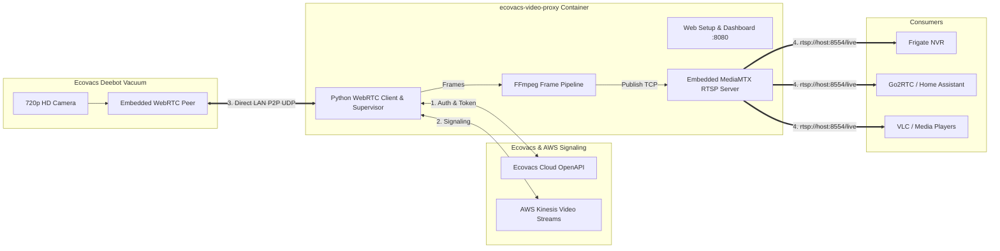

# Ecovacs Deebot Video Proxy

An always-on video proxy that connects to your Ecovacs Deebot robot vacuum camera via P2P WebRTC and re-broadcasts it as low-latency **RTSP** (`rtsp://<host>:8554/live`), **WebRTC** (8889), **HLS** (8888), and **MJPEG** (8080) feeds.
Includes a **built-in web setup wizard** (optimized for **Unraid**, **Proxmox**, and headless NAS environments) with zero terminal commands required.

Designed for seamless integration into **Frigate NVR**, **Go2RTC**, **Home Assistant**, and **VLC**.

---

## Architecture Overview



### Key Highlights
- **Browser-Based Setup (No Terminal Needed)**: Start the container, open `http://<host>:8080`, enter your Ecovacs email, verify the code, and start streaming immediately.
- **Active-Only Streaming (Auto-Night Headlight Sleep)**: Enable the Web UI toggle to shut down the vacuum's camera module and turn off headlights when docked, eliminating nighttime spotlight glare. When docked, MediaMTX pushes an informative standby graphic with live telemetry so NVRs like Frigate never lose stream connection.
- **Real-Time On-Stream Display (OSD)**: Burn live stats directly onto the RTSP feed, HLS, WebRTC, and Web UI player (timestamp, battery level, cleaning mode, station washing/emptying/drying status, maintenance alerts, and robot name). Add or remove fields on the fly from the Web UI in real-time!
- **Direct LAN Media Path**: While initial WebRTC signaling routes through Ecovacs/AWS, the heavy H.264 video traffic flows **directly across your local Wi-Fi** (`robot:UDP <-> container:UDP`) once ICE negotiation completes.
- **Embedded MediaMTX Server**: Includes an embedded, ultra-lightweight RTSP server. No external streaming server required.
- **Always-On Supervisor**: Ecovacs enforces a stream timeout watchdog (~15 min). The bridge maintains continuous `appping` keepalives and automatically re-initiates the WebRTC handshake if the vacuum drops the session, keeping the RTSP endpoint online 24/7.
- **Unraid & Proxmox Ready**: Supports volume mounts to `/config` where generated credentials and configuration persist across container rebuilds.

## 1. Quick Start Guide (Unraid / Proxmox / Docker)

### Step 1: Start the Container

#### Option A: Docker Compose (Recommended)
```bash
# Run pre-built release:
docker compose up -d

# Or build locally from source:
docker compose up -d --build
```
#### Option B: Docker Run (e.g. Unraid / Proxmox / Portainer)
Assuming your env / config is in the ./env folder
```bash
docker run -d \
  --name ecovacs-video-proxy \
  --restart unless-stopped \
  -p 8080:8080 \
  -p 8554:8554 \
  -p 8888:8888 \
  -p 8889:8889 \
  -v /mnt/user/appdata/ecovacs-video-proxy:/config \
  ghcr.io/c4talyst/ecovacs-deebot-video-proxy:1
```

---

### Step 2: Open the Web Setup Wizard

Navigate to **`http://<YOUR_SERVER_IP>:8080`** in your browser.

```
+-------------------------------------------------------------+
|            ECOVACS DEEBOT VIDEO PROXY SETUP WIZARD          |
|                                                             |
|   1. Account Email:    [ user@example.com                 ] |
|   2. Password:         [ ******************               ] |
|   3. Country Code:     [ za                               ] |
|                                                             |
|                  [ CONNECT ACCOUNT ]                        |
+-------------------------------------------------------------+
                              |
                              v (If email verification triggered)
+-------------------------------------------------------------+
|   Ecovacs dispatched a one-time verification code!          |
|   Enter 6-digit Code:  [  •  •  •  •  •  •  ]               |
|                                                             |
|                    [ VERIFY CODE ]                          |
+-------------------------------------------------------------+
                              |
                              v
+-------------------------------------------------------------+
|   Select Vacuum:                                            |
|   (*) DEEBOT X1 OMNI (Living Room)                          |
|   ( ) DEEBOT T10 (Basement)                                 |
|   Camera PIN:          [ Optional                         ] |
|   RTSP Path:           [ live                             ] |
|                                                             |
|             [ SAVE & START STREAMING ]                      |
+-------------------------------------------------------------+
```

1. **Step 1: Account Login**: Enter your Ecovacs email, password, and 2-letter country code (`za`, `us`, `de`, `uk`, etc.).
2. **Step 2: One-Time Verification**: If Ecovacs challenges this client (`code: 1013`), you'll be prompted for the code sent to your email. Enter it to permanently authorize the container.
3. **Step 3: Select Robot**: Pick your vacuum from the discovered list, enter your camera PIN (leave blank if disabled in the app), and click **Save & Start Streaming**.

The configuration is automatically written to `/config/config.yaml`. The video bridge starts broadcasting immediately, displaying a live preview and your RTSP URL!

## 2. Power Saving & Stream Stats Overlay (v1.0.2)

### A. "Only Enable Video When Robot or Station is Active"
Ecovacs vacuums keep their front headlights and camera sensor active whenever a live video session is open. When parked in the charging dock at night, this can illuminate dark rooms.

The Web UI includes a toggle: **"Only enable video when Robot or Station is Active"**:
* **When Docked & Idle**: The container tears down the WebRTC session to the vacuum, allowing the robot to turn off its camera and headlights completely.
* **Continuous RTSP Stream**: The embedded RTSP publisher automatically generates a sleek 1080p/720p standby graphic card showing live battery %, station status, and time. MediaMTX, Frigate NVR, and Go2RTC remain connected without any stream disconnects or errors.
* **Automatic Live Streaming**: As soon as the robot begins cleaning or the station starts a task (washing mop, drying, emptying dustbin), live camera video resumes immediately.
* **On-Demand Camera Wake**: Need to take a quick peek while docked? Click **Wake Camera (5 min)** in the Web UI to temporarily stream without turning off auto-sleep.

### B. Live Stream Telemetry & Stats Overlay (OSD)
Display live diagnostic statistics directly burned into the RTSP feed and Web UI preview.

You can add or remove any of the following fields in **real-time** from the Web UI:
| Field | Description | Example |
| :--- | :--- | :--- |
| **Timestamp** | Current date and time (seconds updated live) | `2026-10-23 21:45:02` |
| **Battery** | Charge percentage and charging indicator | `🔋 95% ⚡` |
| **Robot Mode** | Cleaning, returning, paused, or docked | `Mode: Cleaning` |
| **Station State** | Washing mop, drying mop, emptying dustbin, idle | `Station: Washing Mop` |
| **Maintenance** | Alerts when consumables (filter, brushes) are low | `⚠️ Filter Low (8%)` |
| **Robot Name** | Configured vacuum nickname | `🤖 DEEBOT X1 OMNI` |

**Customizable Positions**: Top-Left, Top-Right, Bottom-Left, Bottom-Right, or Top Banner (Full Width).

---
---

## 3. Local Development Workflow

To iterate quickly without finicky docker commands or rebuilding layers on every code change:

### Option A: Make (Fastest Dev Loop)
The repository includes a [`Makefile`](Makefile) and [`docker-compose.dev.yml`](docker-compose.dev.yml) with **live source code mounting** (`./src:/app/src`).

```bash
# Build and run in foreground with live logs (Ctrl+C to stop):
make dev

# Or run in background:
make up

# Apply Python edits instantly (no rebuild needed):
make restart

# Follow container logs:
make logs

# Stop container:
make down
```

### Option B: Docker Compose Dev
```bash
# Build and start with live code mounting:
docker compose -f docker-compose.dev.yml up --build

# Run detached:
docker compose -f docker-compose.dev.yml up -d --build

# View real-time logs:
docker compose -f docker-compose.dev.yml logs -f
```

### Option C: Single Docker Build & Run Command
```bash
# 1. Build local image
docker build -t ecovacs-video-proxy:local .

# 2. Run container with persistent config
docker run --rm -it \
  --name ecovacs-video-proxy \
  -p 8080:8080 \
  -p 8554:8554 \
  -p 8888:8888 \
  -p 8889:8889 \
  -v "$(pwd)/config:/config" \
  ecovacs-video-proxy:local
```

---

## 4. Headless / Terminal Setup (Alternative)

If you prefer configuring via terminal without the Web UI:

```bash
# Run interactive CLI setup
python3 -m src.setup
```
or supply environment variables directly in [`.env`](.env.example):
```dotenv
ECOVACS_USERNAME="your-email@example.com"
ECOVACS_PASSWORD="your-ecovacs-password"
ECOVACS_COUNTRY="za"
ECOVACS_DEVICE_ID="your-device-id"
ECOVACS_ACCESS_TOKEN="your-access-token"
ECOVACS_USER_ID="your-user-id"
ECOVACS_PIN=""

RTSP_PATH="live"
RTSP_PORT=8554
RTSP_USERNAME="admin"        # Optional: Protects RTSP, WebRTC, HLS & Web UI
RTSP_PASSWORD="supersecret"  # Optional: Protects RTSP, WebRTC, HLS & Web UI
ACTIVE_ONLY_VIDEO="false"    # Set to "true" to only stream when active
OVERLAY_ENABLED="true"       # Set to "true" to burn stats into the feed
OVERLAY_POSITION="top_left"  # top_left, top_right, bottom_left, bottom_right, top_banner
WEB_PORT=8080

---

## 5. Integration Guide
When username and password are set, that single set of credentials automatically protects **all** endpoints (RTSP, WebRTC, HLS, and the HTTP Web UI / MJPEG / Snapshot):
* **RTSP**: `rtsp://<SERVER_IP>:8554/live` (or `rtsp://<user>:<password>@<SERVER_IP>:8554/live`)
* **WebRTC (WHEP)**: `http://<SERVER_IP>:8889/live/whep` (HTTP Basic / Bearer auth with `<user>:<password>`)
* **HLS Web Stream**: `http://<SERVER_IP>:8888/live/` (HTTP Basic Auth with `<user>:<password>`)
* **Live Web Dashboard & MJPEG & Snapshot**: `http://<SERVER_IP>:8080/` (HTTP Basic Auth with `<user>:<password>`)
### A. Frigate NVR
Add the camera feed to your Frigate `config.yml`:

```yaml
cameras:
  deebot_vacuum:
    ffmpeg:
      inputs:
        - path: rtsp://<SERVER_IP>:8554/live
          roles:
            - detect
            - record
    detect:
      width: 1280
      height: 720
      fps: 16
    record:
      enabled: true
      retain:
        days: 3
        mode: motion
```

### B. Go2RTC
Add the stream to your `go2rtc.yaml`:

```yaml
streams:
  deebot_cam:
    - rtsp://<SERVER_IP>:8554/live#backchannel=0
```

### C. Home Assistant (Generic Camera)
1. Go to **Settings** → **Devices & Services** → **Add Integration**.
2. Select **Generic Camera**.
3. Set **Stream Source**: `rtsp://<SERVER_IP>:8554/live`.
4. Set **RTSP transport protocol**: `TCP`.
5. Check **Live preview** and save.

### D. VLC Media Player
1. Open VLC $\rightarrow$ **Media** $\rightarrow$ **Open Network Stream** (`Ctrl+N`).
2. Enter `rtsp://<SERVER_IP>:8554/live` (or `rtsp://<user>:<password>@<SERVER_IP>:8554/live`).
3. Click **Play**.

---

## 6. Automated Multi-Arch Builds (GitHub Packages / GHCR)

The repository includes a ready-to-run GitHub Actions workflow (`.github/workflows/docker-publish.yml`).

When you push this repository to GitHub:
1. GitHub Actions automatically builds multi-architecture images for **`linux/amd64`** (Intel/AMD, Unraid, Proxmox) and **`linux/arm64`** (Raspberry Pi, Apple Silicon).
2. Automatically pushes the image to **GitHub Container Registry (`ghcr.io`)** at:
   ```bash
   ghcr.io/c4talyst/ecovacs-deebot-video-proxy:latest
   ```
3. Images are **free, public, and unthrottled** (no Docker Hub pull rate limits).
4. Users on Unraid or Proxmox can pull the pre-built image directly without local compilation:
   ```bash
   docker pull ghcr.io/c4talyst/ecovacs-deebot-video-proxy:latest
   ```

### Releasing a New Version

To publish an official immutable release (e.g. `v1.0.1`):

1. **Bump the version in `src/__init__.py`**:
   ```python
   __version__ = "1.0.1"
   ```
2. **Commit and push to `main`**:
   ```bash
   git commit -am "chore: bump version to 1.0.1"
   git push origin main
   ```
3. **Create and push the matching git tag**:
   ```bash
   git tag v1.0.1
   git push origin v1.0.1
   ```
   *(Alternatively, create the release in GitHub under **Releases -> Draft a new release**, setting the tag to `v1.0.1`.)*

The workflow validates that the tag matches `__version__` in `src/__init__.py` and automatically publishes:
- `ghcr.io/c4talyst/ecovacs-deebot-video-proxy:1.0.3` (exact release)
- `ghcr.io/c4talyst/ecovacs-deebot-video-proxy:1.0` (latest minor)
- `ghcr.io/c4talyst/ecovacs-deebot-video-proxy:1` (latest major)

---

## 7. Reconnection & Keepalive Architecture

### Ecovacs Watchdog Prevention
Ecovacs vacuums power down their camera module if they do not receive regular heartbeats (`appping`) through their cloud gateway (`api-ngiot.dc-na.ww.ecouser.net`).

The bridge executes an asynchronous background task sending `appping` every 35 seconds. If the vacuum docks, pauses, or breaks the WebRTC link, the supervisor automatically tears down the peer and initiates a fresh session with exponential backoff.

### Embedded MediaMTX Persistence
MediaMTX runs as an independent daemon within the container. When the vacuum drops a session or transitions states, the RTSP publisher temporarily stops pushing frames, but **MediaMTX keeps the RTSP listener open on port 8554**. Consumers like Frigate or Go2RTC remain connected without crashing or repeatedly logging connection refused errors.

---
## 8. Port Reference

| Port | Protocol | Purpose |
| :--- | :--- | :--- |
| **`8080`** | HTTP | Web Setup Wizard & Live Stream Dashboard |
| **`8554`** | TCP/UDP | RTSP Video Stream (`rtsp://<host>:8554/live`) |
| **`8888`** | HTTP | HLS Web Player (`http://<host>:8888/live`) |
| **`8889`** | HTTP/WebRTC | MediaMTX WebRTC Stream |

---

## 9. License & Disclaimer
This project is licensed under the [MIT License](LICENSE).

This project is an independent community reverse-engineering tool and is not affiliated with, endorsed by, or supported by ECOVACS Robotics. Use at your own risk.
