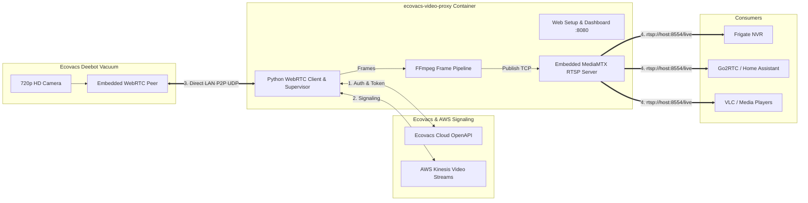

# Ecovacs Deebot Video Proxy

An always-on video proxy that connects to your Ecovacs Deebot robot vacuum camera via P2P WebRTC and re-broadcasts it as low-latency **RTSP** (`rtsp://<host>:8554/live`), **WebRTC** (8889), **HLS** (8888), and **MJPEG** (8080) feeds.
Includes a **built-in web setup wizard** (optimized for **Unraid**, **Proxmox**, and headless NAS environments) with zero terminal commands required.

Designed for seamless integration into **Frigate NVR**, **Go2RTC**, **Home Assistant**, and **VLC**.

---

## Architecture Overview



### Key Highlights
- **Browser-Based Setup (No Terminal Needed)**: Start the container, open `http://<host>:8080`, enter your Ecovacs email, verify the code, and start streaming immediately.
- **Direct LAN Media Path**: While initial WebRTC signaling routes through Ecovacs/AWS, the heavy H.264 video traffic flows **directly across your local Wi-Fi** (`robot:UDP <-> container:UDP`) once ICE negotiation completes.
- **Embedded MediaMTX Server**: Includes an embedded, ultra-lightweight RTSP server. No external streaming server required.
- **Always-On Supervisor**: Ecovacs enforces a stream timeout watchdog (~15 min). The bridge maintains continuous `appping` keepalives and automatically re-initiates the WebRTC handshake if the vacuum drops the session, keeping the RTSP endpoint online 24/7.
- **Unraid & Proxmox Ready**: Supports volume mounts to `/config` where generated credentials and configuration persist across container rebuilds.

---

## 1. Quick Start Guide (Unraid / Proxmox / Docker)

### Step 1: Start the Container

#### With Docker Compose:
```bash
docker compose up -d
```

#### With Docker Run (e.g. Unraid / Proxmox / Portainer):
```bash
docker run -d \
  --name ecovacs-video-proxy \
  --restart unless-stopped \
  -p 8080:8080 \
  -p 8554:8554 \
  -p 8888:8888 \
  -p 8889:8889 \
  -v /mnt/user/appdata/ecovacs-video-proxy:/config \
  ecovacs-video-proxy
```

---

### Step 2: Open the Web Setup Wizard

Navigate to **`http://<YOUR_SERVER_IP>:8080`** in your browser.

```
+-------------------------------------------------------------+
|            ECOVACS DEEBOT VIDEO PROXY SETUP WIZARD          |
|                                                             |
|   1. Account Email:    [ user@example.com                 ] |
|   2. Password:         [ ******************               ] |
|   3. Country Code:     [ za                               ] |
|                                                             |
|                  [ CONNECT ACCOUNT ]                        |
+-------------------------------------------------------------+
                              |
                              v (If email verification triggered)
+-------------------------------------------------------------+
|   Ecovacs dispatched a one-time verification code!          |
|   Enter 6-digit Code:  [  •  •  •  •  •  •  ]               |
|                                                             |
|                    [ VERIFY CODE ]                          |
+-------------------------------------------------------------+
                              |
                              v
+-------------------------------------------------------------+
|   Select Vacuum:                                            |
|   (*) DEEBOT X1 OMNI (Living Room)                          |
|   ( ) DEEBOT T10 (Basement)                                 |
|   Camera PIN:          [ Optional                         ] |
|   RTSP Path:           [ live                             ] |
|                                                             |
|             [ SAVE & START STREAMING ]                      |
+-------------------------------------------------------------+
```

1. **Step 1: Account Login**: Enter your Ecovacs email, password, and 2-letter country code (`za`, `us`, `de`, `uk`, etc.).
2. **Step 2: One-Time Verification**: If Ecovacs challenges this client (`code: 1013`), you'll be prompted for the code sent to your email. Enter it to permanently authorize the container.
3. **Step 3: Select Robot**: Pick your vacuum from the discovered list, enter your camera PIN (leave blank if disabled in the app), and click **Save & Start Streaming**.

The configuration is automatically written to `/config/config.yaml`. The video bridge starts broadcasting immediately, displaying a live preview and your RTSP URL!

---

## 2. Headless / Terminal Setup (Alternative)

If you prefer configuring via terminal without the Web UI:

```bash
# Run interactive CLI setup
python3 -m src.setup
```
or supply environment variables directly in [`.env`](.env.example):
```dotenv
ECOVACS_USERNAME="your-email@example.com"
ECOVACS_PASSWORD="your-ecovacs-password"
ECOVACS_COUNTRY="za"
ECOVACS_DEVICE_ID="your-device-id"
ECOVACS_ACCESS_TOKEN="your-access-token"
ECOVACS_USER_ID="your-user-id"
ECOVACS_PIN=""

RTSP_PATH="live"
RTSP_PORT=8554
RTSP_USERNAME="admin"        # Optional: Set to require credentials
RTSP_PASSWORD="supersecret"  # Optional: Set to require credentials
WEB_PORT=8080
```

---
## 3. Integration Guide
Once streaming, the video feed is available at:
* **RTSP (No Auth)**: `rtsp://<SERVER_IP>:8554/live`
* **RTSP (With Auth)**: `rtsp://<user>:<password>@<SERVER_IP>:8554/live`
* **HLS Web Stream**: `http://<SERVER_IP>:8888/live`
* **WebRTC**: `http://<SERVER_IP>:8889/live`
* **Live Web Dashboard & Snapshot**: `http://<SERVER_IP>:8080/`
### A. Frigate NVR
Add the camera feed to your Frigate `config.yml`:

```yaml
cameras:
  deebot_vacuum:
    ffmpeg:
      inputs:
        - path: rtsp://<SERVER_IP>:8554/live
          roles:
            - detect
            - record
    detect:
      width: 1280
      height: 720
      fps: 16
    record:
      enabled: true
      retain:
        days: 3
        mode: motion
```

### B. Go2RTC
Add the stream to your `go2rtc.yaml`:

```yaml
streams:
  deebot_cam:
    - rtsp://<SERVER_IP>:8554/live#backchannel=0
```

### C. Home Assistant (Generic Camera)
1. Go to **Settings** → **Devices & Services** → **Add Integration**.
2. Select **Generic Camera**.
3. Set **Stream Source**: `rtsp://<SERVER_IP>:8554/live`.
4. Set **RTSP transport protocol**: `TCP`.
5. Check **Live preview** and save.

### D. VLC Media Player
1. Open VLC $\rightarrow$ **Media** $\rightarrow$ **Open Network Stream** (`Ctrl+N`).
2. Enter `rtsp://<SERVER_IP>:8554/live` (or `rtsp://<user>:<password>@<SERVER_IP>:8554/live`).
3. Click **Play**.

---

## 4. Automated Multi-Arch Builds (GitHub Packages / GHCR)

The repository includes a ready-to-run GitHub Actions workflow (`.github/workflows/docker-publish.yml`).

When you push this repository to GitHub:
1. GitHub Actions automatically builds multi-architecture images for **`linux/amd64`** (Intel/AMD, Unraid, Proxmox) and **`linux/arm64`** (Raspberry Pi, Apple Silicon).
2. Automatically pushes the image to **GitHub Container Registry (`ghcr.io`)** at:
   ```bash
   ghcr.io/<your-github-username>/ecovacs-video-proxy:latest
   ```
3. Images are **free, public, and unthrottled** (no Docker Hub pull rate limits).
4. Users on Unraid or Proxmox can pull the pre-built image directly without local compilation:
   ```bash
   docker pull ghcr.io/<your-github-username>/ecovacs-video-proxy:latest
   ```

### Releasing a New Version

To publish an official immutable release (e.g. `v1.0.1`):

1. **Bump the version in `src/__init__.py`**:
   ```python
   __version__ = "1.0.1"
   ```
2. **Commit and push to `main`**:
   ```bash
   git commit -am "chore: bump version to 1.0.1"
   git push origin main
   ```
3. **Create and push the matching git tag**:
   ```bash
   git tag v1.0.1
   git push origin v1.0.1
   ```
   *(Alternatively, create the release in GitHub under **Releases -> Draft a new release**, setting the tag to `v1.0.1`.)*

The workflow validates that the tag matches `__version__` in `src/__init__.py` and automatically publishes:
- `ghcr.io/<repo>:1.0.1` (exact release)
- `ghcr.io/<repo>:1.0` (latest minor)
- `ghcr.io/<repo>:1` (latest major)

---

## 5. Reconnection & Keepalive Architecture

### Ecovacs Watchdog Prevention
Ecovacs vacuums power down their camera module if they do not receive regular heartbeats (`appping`) through their cloud gateway (`api-ngiot.dc-na.ww.ecouser.net`).

The bridge executes an asynchronous background task sending `appping` every 35 seconds. If the vacuum docks, pauses, or breaks the WebRTC link, the supervisor automatically tears down the peer and initiates a fresh session with exponential backoff.

### Embedded MediaMTX Persistence
MediaMTX runs as an independent daemon within the container. When the vacuum drops a session or transitions states, the RTSP publisher temporarily stops pushing frames, but **MediaMTX keeps the RTSP listener open on port 8554**. Consumers like Frigate or Go2RTC remain connected without crashing or repeatedly logging connection refused errors.

---
## 6. Port Reference

| Port | Protocol | Purpose |
| :--- | :--- | :--- |
| **`8080`** | HTTP | Web Setup Wizard & Live Stream Dashboard |
| **`8554`** | TCP/UDP | RTSP Video Stream (`rtsp://<host>:8554/live`) |
| **`8888`** | HTTP | HLS Web Player (`http://<host>:8888/live`) |
| **`8889`** | HTTP/WebRTC | MediaMTX WebRTC Stream |

---

## 7. License & Disclaimer
This project is licensed under the [MIT License](LICENSE).

This project is an independent community reverse-engineering tool and is not affiliated with, endorsed by, or supported by ECOVACS Robotics. Use at your own risk.
